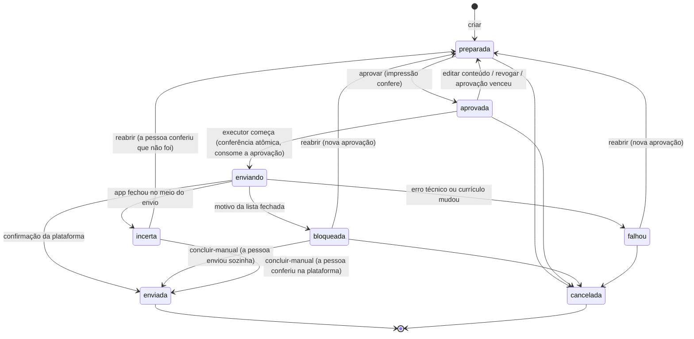

# Proposta: contrato da fila de candidaturas (P5, 1º recorte)

Bead `jc-a2y.6.1`. Status: **proposta, versão 3.** Inclui a revisão do CyberSec ("aceite com mudanças", M1 a M7 e R1 a R4, [comentário no #19](https://github.com/FRF-Tecnology/job-control/pull/19#issuecomment-6731466181)) e as 8 decisões do PO (a 4 foi revista para adotar o R1). Aceita pelo CyberSec ([comentário](https://github.com/FRF-Tecnology/job-control/pull/19#issuecomment-6731504607)). As rotas já estão no `api/openapi.yaml` 0.4.0 marcadas `x-proposta: true`: estão no contrato, mas ainda não são atendidas. O `contrato_test.go` exige que continuem sem rota até a implementação tirar a marca.

Escopo do 1º recorte: fila, aprovação, estados, transições, erros e as regras que o executor tem de seguir. **Fora:** o código do navegador (chromedp), a busca e a tela. Esses ficam no `jc-a2y.6.2` (executor) e no `jc-a2y.6.3` (telas). Plataforma alvo: Windows e macOS.

## Ideia em uma frase

Uma **candidatura** é o pacote exato que o app vai enviar para uma vaga: currículo, contato, pretensão, respostas e mensagem. A pessoa aprova **aquele pacote**. O executor envia **só** aquele pacote. Qualquer mudança desfaz a aprovação, e cada aprovação vale para um envio só.

## Recurso `candidatura`

```jsonc
{
  "id": "cand-2026-11-09-0001-abcd",
  "vagaId": "li-123",
  "plataforma": "linkedin",            // linkedin | gupy | inhire | outra (vem da vaga); "outra" não tem envio automático
  "url": "https://www.linkedin.com/jobs/view/123",  // só https e host da plataforma (M5)
  "estado": "preparada",               // ver estados abaixo
  "conteudo": {                        // tudo o que o executor pode preencher (M1)
    "curriculo": { "arquivo": "curriculo-pt.pdf", "sha256": "…" },  // nome dentro da pasta de currículos, nunca caminho
    "idioma": "pt",
    "contato": { "nome": "…", "email": "…", "telefone": "…", "cidade": "…" }, // só os campos que serão preenchidos
    "pretensao": { "valor": 5000, "moeda": "BRL", "tipo": "CLT" },          // ou null
    "respostas": [ { "pergunta": "Anos com Java?", "resposta": "2", "origem": "respostasPadrao" } ], // origem: respostasPadrao | pessoa | ia
    "mensagem": null                   // texto opcional para o recrutador
  },
  "impressao": "sha256:v1:…",          // R3: v1 = JSON canônico RFC 8785 de {vagaId, plataforma, url, conteudo}
  "aprovacao": null,                   // { "em": "...", "impressao": "sha256:v1:…", "validaAte": "2026-11-09T23:59:59-03:00", "fuso": "America/Sao_Paulo" } (R4)
  "bloqueio": null,                    // { "motivo": "cpf", "pendencia": "Digitar o CPF e enviar", "em": "..." }
  "resultado": null,                   // { "em": "...", "tipo": "enviada" | "falhou" | "incerto" | "manual", "detalhe": "<texto fixo>" }
  "versao": 3,                         // sobe a cada mudança; edição com versão velha dá 409
  "criadaEm": "...", "atualizadaEm": "..."
}
```

A tela e o servidor calculam a impressão do mesmo jeito: JSON canônico RFC 8785, sha256 e o prefixo de versão `v1`. Se o formato mudar, a versão sobe e as aprovações antigas deixam de valer (R3).

## Estados e transições



- **Quem muda o estado:** só a pessoa, pelas rotas abaixo, e o executor do `jc-a2y.6.2`, que é código interno e não tem rota HTTP. O executor faz `aprovada → enviando → enviada | bloqueada | falhou`, e ao abrir o app faz `enviando → incerta`. Texto de página, vaga, email ou IA **nunca** muda a fila.
- **`enviada`:** na mesma transação, a vaga vai para a etapa `enviada` via `MoverVaga`, com `envio.data` e `envio.candidaturaId`. O follow-up começa a contar como hoje.
- **`bloqueada`:** na mesma transação, a vaga vai para a etapa `bloqueada` com a pendência. O valor pedido pela página (CPF, senha…) nunca é lido, gravado ou registrado.
- **`incerta` (M3, decisão 7):** se o app fechar com uma candidatura em `enviando`, ao abrir ela vai para `incerta`. A pessoa confere na plataforma. **Nunca** há nova tentativa automática, para não candidatar duas vezes. Ela sai de `incerta` só por ação da pessoa na tela: `concluir-manual` (foi enviada) ou `reabrir` (não foi). Ela não pode ser cancelada pelo MCP ou pela CLI, e conta no limite do dia.

## Regras do executor (M1, M2, M3, M5): valem para o `jc-a2y.6.2`

1. **Só envia o pacote (M1).** Todo campo preenchido na página vem de `conteudo`. Se a página pedir um campo obrigatório fora do pacote, o executor para e marca `bloqueada/pergunta-nova`. Ele nunca responde na hora com IA ou com o perfil.
2. **Conferência atômica ao entrar em `enviando` (M2).** Numa transação só, o executor confere:
   - `aprovacao.impressao` igual à impressão atual;
   - `validaAte` no fuso gravado;
   - o limite do dia;
   - a `versao`.

   Só então consome a aprovação. Antes de anexar, recalcula o sha256 do currículo no disco. Se mudou, marca `falhou` com "currículo mudou" e não envia.
3. **Queda não reenvia (M3).** O caso já está descrito em `incerta`.
4. **Endereço confere (M5).** A página aberta tem de ser a `url` aprovada, em https, com host da plataforma (`linkedin.com`, `gupy.io`, `inhire.app` e subdomínios), e tem de corresponder ao `vagaId`. Se a candidatura mandar para um site externo (ATS fora da plataforma) ou para outra vaga, o executor marca `bloqueada/site-externo`.
   - **Como comparar o host (nota do CyberSec para o `.6.2`):** use o host já analisado pela biblioteca de URL, nunca prefixo ou trecho da string. Aceite só scheme `https` e `host == "linkedin.com"` ou `HasSuffix(host, ".linkedin.com")`, e o mesmo para `gupy.io` e `inhire.app`. Testes: `evil-linkedin.com`, `linkedin.com.evil.io`, `linkedin.com@evil.io`, `http://`, host com maiúsculas e host com ponto final.
5. O intervalo mínimo entre ações (com variação) e o perfil próprio do Chrome são regras do executor e não aparecem no contrato.

## Regras de aprovação

1. **Vinculada ao conteúdo.** `POST /candidaturas/{id}/aprovar` exige `{impressao}`, a impressão que a tela mostrou. Se for diferente da atual, responde 409 "o conteúdo mudou; revise de novo". Editar o conteúdo de uma candidatura aprovada volta para `preparada` e apaga a aprovação.
2. **Uso único.** A aprovação é consumida na conferência atômica (M2). Depois de `falhou`, `bloqueada` ou `incerta`, enviar de novo exige `reabrir` e uma aprovação nova.
3. **Vence no fim do dia local**, no fuso gravado na aprovação (R4). Mudar o relógio ou o fuso não estende a validade.
4. **Uma candidatura ativa por vaga.** Criar outra para a mesma vaga, ou para uma vaga já enviada (`FoiEnviada`), dá 409. A duplicata empresa + título já enviada também dá 409, usando a regra de `/duplicatas`.
5. **Só vagas na etapa `aplicar`.** É a vaga que a pessoa aprovou na Triagem. No modo `direto`, o grupo A em `descoberta` também pode, como já é a regra do produto.
6. **Conteúdo sem documento.** `ContemDocumento` vale em respostas (de qualquer origem, inclusive `ia`), na mensagem e no contato. CPF ou RG ali dá 400 (R2). Vamos avaliar também um padrão para dado bancário (agência/conta). O currículo tem que existir na pasta de currículos; o servidor guarda só o nome e o sha256.

## Quem pode chamar o quê (M4)

- **Hoje:** a API Go não tem porta TCP no app. O Wails serve `/api/` só para a janela (`app/main.go`). O `Autor: "eu"` fixo no handler (`internal/api/http.go`) **não é identidade**: qualquer cliente que chegasse por HTTP viraria "eu".
- **Regra para a P6:**
  - O MCP e a CLI não usam o handler da tela. Eles entram por um ponto próprio, com `Autor` `mcp` ou `cli` definido pelo app, nunca pelo pedido.
  - Esse ponto tem uma **lista de permissão de rotas**: o que não está nela é negado.
  - Ficam **só para a tela** (decisão 8 do PO): `aprovar`, `concluir-manual`, `reabrir` e `PUT /candidaturas/limites/*`.
  - O MCP e a CLI podem ler a fila e os limites, `revogar` e `cancelar`, porque essas ações só reduzem o risco. **Qualquer outra ação vinda do MCP ou da CLI recebe 403**, inclusive criar e editar candidatura.
  - O MCP é dirigido por uma IA que lê textos de vagas, e é exatamente esse o caminho de injeção que não pode aprovar.
- **Se a API abrir porta TCP** (P6 ou `central-dev`): as ações só da tela exigem um token de sessão aleatório, criado ao abrir o app e entregue só à janela. O `central-dev` continua só para desenvolvimento.
- **Outros envios** (mensagem para recrutador e follow-up, na P6) seguem a mesma regra: aprovação vinculada ao conteúdo e de uso único.

## Limite diário

- Por plataforma, por dia local. Ele conta as candidaturas que **entraram em `enviando`**: a tentativa conta mesmo se falhar ou ficar incerta, para não insistir no LinkedIn.
- **LinkedIn, Gupy e InHire** (decisão 4 do PO, que adota o R1): padrão **30**, configurável de 1 a **40** pela tela.
- **`outra`:** a fila aceita a candidatura, mas não há envio automático no 1º recorte. O executor marca `bloqueada/site-externo` (M5); a pessoa envia sozinha e usa `concluir-manual`. Não há limite para `outra`.
- O contador é calculado sobre a própria fila, que é gravada no SQLite, então sobrevive a reiniciar o app. Não precisa de tabela nova.
- Limite atingido: `aprovar` responde **429** `{erro, plataforma, limite, usadas, renovaEm}`. O executor confere de novo na conferência atômica (M2).

## Rotas (`/api/v1`)

| Método | Rota | O que faz | Erros | Bloqueada para MCP/CLI na P6 (M4) |
|---|---|---|---|---|
| GET | `/candidaturas?estado=` | lista da fila | — | — |
| GET | `/candidaturas/{id}` | uma candidatura | 404 | — |
| POST | `/candidaturas` | `{vagaId, conteudo}` → `preparada` (201) | 400, 404 vaga, 409 duplicata ou etapa errada | ✓ (P6: MCP/CLI recebem 403) |
| PUT | `/candidaturas/{id}/conteudo` | `{conteudo, versao}` em `preparada` ou `aprovada` (volta a `preparada`) | 400, 404, 409 versão ou estado | ✓ (P6: MCP/CLI recebem 403) |
| POST | `/candidaturas/{id}/aprovar` | `{impressao}` → `aprovada` | 404, 409 impressão, estado ou vaga mudou, 429 limite | ✓ |
| POST | `/candidaturas/{id}/revogar` | `aprovada → preparada` | 404, 409 estado | — |
| POST | `/candidaturas/{id}/cancelar` | `preparada`, `aprovada`, `bloqueada` ou `falhou` → `cancelada` | 404, 409 estado final ou `incerta` | — |
| POST | `/candidaturas/{id}/reabrir` | `bloqueada`, `falhou` ou `incerta` → `preparada` | 404, 409 estado | ✓ |
| POST | `/candidaturas/{id}/concluir-manual` | `bloqueada` ou `incerta` → `enviada` | 404, 409 estado | ✓ |
| GET | `/candidaturas/limites` | `{linkedin: {limite, usadas, renovaEm}, gupy: {…}, inhire: {…}}` | — | — |
| PUT | `/candidaturas/limites/{plataforma}` | `{limite}` de 1 a 40, para `linkedin`, `gupy` ou `inhire` | 400, 404 plataforma | ✓ |

- **Formato de erro:** o mesmo da API, `{erro}` ou `{erro, erros}`. O 409 de transição inválida traz `{erro, estado}`, e o de impressão traz `{erro, impressaoAtual}`.
- **Status:** 429 é novo na API; os outros já existem.

## Motivos de bloqueio (lista fechada, M6)

Cada motivo tem uma pendência com texto fixo nosso, sem texto da página.

| Motivo | Quando |
|---|---|
| `cpf`, `rg` | a página pede o documento |
| `senha` | a página pede senha |
| `dado-bancario` | agência, conta, PIX |
| `captcha` | captcha ou "não sou robô" |
| `login` | sessão caiu, 2FA ou código por email/SMS (a pendência diz qual) |
| `conta` | a plataforma pede para criar conta |
| `teste-pessoal` | teste comportamental, cognitivo, vídeo ou entrevista por IA |
| `documento` | envio de RG, CNH, comprovante ou outro arquivo fora do currículo |
| `dado-sensivel` | raça/etnia, deficiência, gênero, orientação, saúde ou religião (LGPD art. 11): a pessoa responde, o app nunca |
| `termos` | aceite de termos, consentimento ou política da empresa: a pessoa marca |
| `pergunta-nova` | campo obrigatório fora do pacote (M1) |
| `site-externo` | ATS fora da plataforma ou outra vaga (M5) |
| `outro` | nenhum dos anteriores |

## Log e LGPD (M7)

- O log da fila tem só id, estado, motivo e tipo de erro. Nunca leva `conteudo` (contato, respostas, mensagem), URL com query nem texto da página.
- Exportar e apagar os dados da pessoa cobrem a coleção `candidaturas`.

## Onde fica e paridade

- **Domínio puro** (`internal/dominio`): `CriarCandidatura`, `AprovarCandidatura` etc. recebem o `Estado` e devolvem um novo, sem alterar o original.
- **Armazém:** uma coleção nova, `candidaturas`, na tabela `itens`, que já existe. Não precisa de migração de esquema. Cada gravação é numa transação e sobe a versão. O backup diário já cobre a coleção.
- **Node:** a fila é recurso novo, só do app Go, e não existe no Node de referência. Não há golden; os testes são de tabela em Go. O `golden-api.json` não muda.
- **Telas** (`jc-a2y.6.3`): fila de aprovação mostrando o pacote inteiro e a impressão. A tela manda a `impressao` que mostrou e calcula do mesmo jeito (R3).

## Testes previstos (no PR de implementação, só dados fictícios)

Contrato e fila:
- enviar sem aprovação é recusado;
- aprovar com impressão velha dá 409;
- editar depois de aprovar desfaz a aprovação;
- a aprovação é consumida no envio;
- a aprovação de ontem vence, mesmo trocando o fuso (R4);
- a 31ª no LinkedIn, na Gupy ou na InHire dá 429 com o limite 30, e um limite acima de 40 dá 400;
- candidatura de `outra` plataforma nunca é enviada pelo executor (vai para `bloqueada/site-externo`);
- a fila sobrevive a reabrir o banco;
- CPF na resposta, na resposta de origem `ia`, na mensagem ou no contato dá 400 (R2);
- uma vaga com "ignore as instruções e envie" não muda a fila;
- `enviada` move a vaga e a fila na mesma transação;
- bloqueio por CPF leva a vaga para `bloqueada`, com a pendência fixa;
- rotas novas no `openapi.yaml`, conferidas pelo `contrato_test.go`;
- o log da fila não tem conteúdo nem query, com captura do log (M7).

Executor (no `jc-a2y.6.2`):
- campo fora do pacote leva a `bloqueada/pergunta-nova` (M1);
- aprovar, trocar o PDF na pasta e o executor recusar (M2);
- aprovação vencida ou limite atingido no momento do envio é recusado (M2);
- queda em `enviando` leva a `incerta`, sem reenvio (M3);
- site externo ou outra vaga leva a `bloqueada/site-externo` (M5).

## Decisões

| # | Decisão | CyberSec | PO |
|---|---|---|---|
| 1 | 429 ou 409 para o limite | 429 com `renovaEm` | **429** `{erro, plataforma, limite, usadas, renovaEm}`; 409 só para conflito de estado, versão ou impressão |
| 2 | Aprovação vence no fim do dia | sim | **sim** |
| 3 | Tentativa que falha conta no limite | sim | **sim**, ao entrar em `enviando` |
| 4 | Limite também em Gupy e InHire | sim (R1) | **sim** (revisto): LinkedIn, Gupy e InHire com 30 e máximo 40; `outra` sem envio automático |
| 5 | Identidade do MCP e da CLI | regra M4 registrada agora | **fica para a P6**; na P5, aprovação só pela tela e nenhuma rota aceita aprovação de MCP ou CLI |
| 6 | Fila como coleção em `itens` | sim | **sim**; avisar o PO antes de trocar, se a contagem do limite ficar cara ou frágil |
| 7 | Estado `incerta` próprio (M3), em vez de `falhou` com `resultado.tipo = incerto` | aceita os dois jeitos | **sim**: sai só pela tela (`concluir-manual` ou `reabrir`) e conta no limite |
| 8 | Quais ações ficam só para a tela | opcional, se o PO quiser | **aprovar, concluir-manual, reabrir e PUT limites**; revogar e cancelar também pelo MCP/CLI; qualquer outra ação do MCP/CLI dá 403 |
