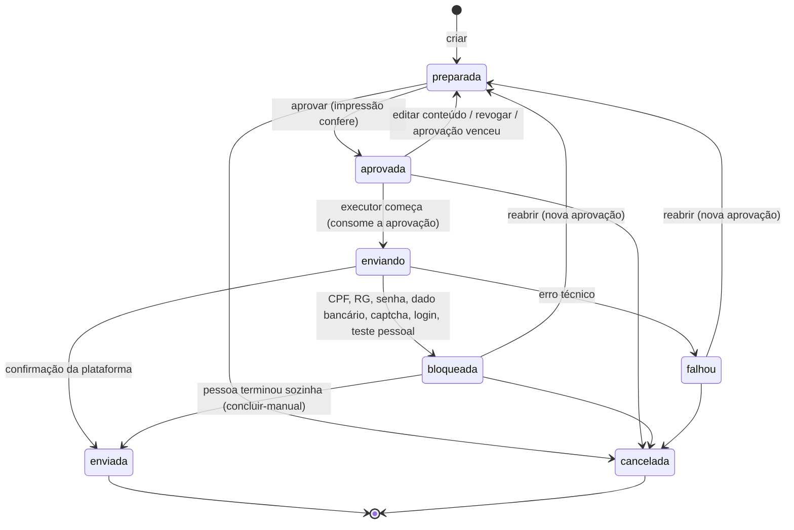

# Proposta: contrato da fila de candidaturas (P5, 1º recorte)

Bead `jc-a2y.6.1`. Status: **proposta para o PO e o CyberSec**. Nada aqui está implementado; o `api/openapi.yaml` só muda quando a proposta for aceita, junto com as rotas (o teste do contrato exige rota atendida).

Escopo do 1º recorte: fila, aprovação, estados, transições e erros. **Fora:** navegador (chromedp), busca, preenchimento de formulários e tela. Esses ficam no `jc-a2y.6.2` (executor) e no `jc-a2y.6.3` (telas). Plataforma alvo: Windows e macOS.

## Ideia em uma frase

Uma **candidatura** é o pacote exato que o app vai enviar para uma vaga: currículo, respostas e mensagem. A pessoa aprova **aquele pacote**. Qualquer mudança no pacote desfaz a aprovação, e cada aprovação vale para um envio só.

## Recurso `candidatura`

```jsonc
{
  "id": "cand-2026-11-09-0001-abcd",
  "vagaId": "li-123",
  "plataforma": "linkedin",            // linkedin | gupy | inhire | outra (vem da vaga)
  "url": "https://www.linkedin.com/jobs/view/123",
  "estado": "preparada",               // ver estados abaixo
  "conteudo": {
    "curriculo": { "arquivo": "curriculo-pt.pdf", "sha256": "…" },  // nome dentro da pasta de currículos, nunca caminho
    "idioma": "pt",
    "respostas": [ { "pergunta": "Anos com Java?", "resposta": "2", "origem": "respostasPadrao" } ], // origem: respostasPadrao | pessoa | ia
    "mensagem": null                   // texto opcional para o recrutador
  },
  "impressao": "sha256:…",             // calculada pelo servidor sobre vagaId + plataforma + url + conteudo (JSON canônico)
  "aprovacao": null,                   // { "em": "...", "impressao": "sha256:…", "validaAte": "fim do dia local" }
  "bloqueio": null,                    // { "motivo": "cpf", "pendencia": "Digitar o CPF e enviar", "em": "..." }
  "resultado": null,                   // { "em": "...", "tipo": "enviada" | "falhou" | "manual" }
  "versao": 3,                         // sobe a cada mudança; edição com versão velha dá 409
  "criadaEm": "...", "atualizadaEm": "..."
}
```

## Estados e transições



- **Quem muda o estado:** só a pessoa, pelas rotas abaixo, e o executor do `jc-a2y.6.2`, que é código interno e não tem rota HTTP. O executor faz `aprovada → enviando → enviada | bloqueada | falhou`. Texto de página, vaga, email ou IA **nunca** muda a fila.
- **`enviada`:** na mesma transação, a vaga vai para a etapa `enviada` via `MoverVaga`, com `envio.data` e `envio.candidaturaId`. O follow-up começa a contar como hoje.
- **`bloqueada`:** na mesma transação, a vaga vai para a etapa `bloqueada` com a pendência. O valor pedido pela página (CPF, senha…) nunca é lido, gravado ou registrado.

## Regras de aprovação (para o CyberSec conferir)

1. **Vinculada ao conteúdo.** `POST /candidaturas/{id}/aprovar` exige `{impressao}`, a impressão que a tela mostrou. Se for diferente da atual, responde 409 "o conteúdo mudou; revise de novo". Editar o conteúdo de uma candidatura aprovada volta para `preparada` e apaga a aprovação.
2. **Uso único.** A aprovação é consumida quando o executor entra em `enviando`. Depois de `falhou` ou `bloqueada`, enviar de novo exige `reabrir` e uma aprovação nova.
3. **Vence no fim do dia local.** Uma aprovação de ontem não envia hoje: a candidatura volta para `preparada`.
4. **Só a pessoa aprova.** A rota de aprovar exige pedido da tela: JSON, mesma origem (como hoje) e `Autor = "eu"`. **Ponto em aberto (CyberSec, P6):** quando o MCP e a CLI chamarem a API Go, eles precisam de identidade própria e devem receber 403 em `aprovar` e `concluir-manual`.
5. **Uma candidatura ativa por vaga.** Criar outra para a mesma vaga, ou para uma vaga já enviada (`FoiEnviada`), dá 409. A duplicata empresa + título já enviada também dá 409, usando a regra de `/duplicatas`.
6. **Só vagas na etapa `aplicar`.** É a vaga que a pessoa aprovou na Triagem. No modo `direto`, o grupo A em `descoberta` também pode, como já é a regra do produto.
7. **Conteúdo sem documento.** Respostas e mensagem com CPF ou RG dão 400 (`ContemDocumento`). O currículo tem que existir na pasta de currículos; o servidor guarda só o nome e o sha256.

## Limite diário

- Por plataforma, por dia local. Ele conta as candidaturas que **entraram em `enviando`**: a tentativa conta mesmo se falhar, para não insistir no LinkedIn.
- LinkedIn: padrão **30**, máximo **40** (checklist do CyberSec). As outras plataformas ficam sem limite no 1º recorte.
- O contador é calculado sobre a própria fila, que é gravada no SQLite, então sobrevive a reiniciar o app. Não precisa de tabela nova.
- Limite atingido: `aprovar` responde **429** `{erro, plataforma, limite, usadas, renovaEm}`. O executor também confere antes de começar.
- O intervalo mínimo entre ações (com variação) é do executor (`jc-a2y.6.2`) e não aparece no contrato.

## Rotas (`/api/v1`)

| Método | Rota | O que faz | Erros |
|---|---|---|---|
| GET | `/candidaturas?estado=` | lista da fila | — |
| GET | `/candidaturas/{id}` | uma candidatura | 404 |
| POST | `/candidaturas` | `{vagaId, conteudo}` → `preparada` (201) | 400, 404 vaga, 409 duplicata ou etapa errada |
| PUT | `/candidaturas/{id}/conteudo` | `{conteudo, versao}` em `preparada` ou `aprovada` (volta a `preparada`) | 400, 404, 409 versão ou estado |
| POST | `/candidaturas/{id}/aprovar` | `{impressao}` → `aprovada` | 404, 409 impressão, estado ou vaga mudou, 429 limite |
| POST | `/candidaturas/{id}/revogar` | `aprovada → preparada` | 404, 409 estado |
| POST | `/candidaturas/{id}/cancelar` | → `cancelada` | 404, 409 estado final |
| POST | `/candidaturas/{id}/reabrir` | `bloqueada` ou `falhou` → `preparada` | 404, 409 estado |
| POST | `/candidaturas/{id}/concluir-manual` | `bloqueada → enviada` (a pessoa enviou sozinha) | 404, 409 estado |
| GET | `/candidaturas/limites` | `{linkedin: {limite, usadas, renovaEm}, …}` | — |
| PUT | `/candidaturas/limites/{plataforma}` | `{limite}`; LinkedIn de 1 a 40 | 400 |

- **Formato de erro:** o mesmo da API, `{erro}` ou `{erro, erros}`. O 409 de transição inválida traz `{erro, estado}`, e o de impressão traz `{erro, impressaoAtual}`.
- **Status:** 429 é novo na API (os outros já existem). **Decisão do PO:** 429 ou 409 para o limite.
- **Motivos de bloqueio:** lista fechada `cpf | rg | senha | dado-bancario | captcha | login | conta | teste-pessoal | outro`. Cada motivo tem uma pendência com texto fixo nosso, sem texto da página.

## Onde fica e paridade

- **Domínio puro** (`internal/dominio`): `CriarCandidatura`, `AprovarCandidatura` etc. recebem o `Estado` e devolvem um novo, sem alterar o original.
- **Armazém:** uma coleção nova, `candidaturas`, na tabela `itens`, que já existe. Não precisa de migração de esquema. Cada gravação é numa transação e sobe a versão. O backup diário já cobre a coleção.
- **Node:** a fila é recurso novo, só do app Go, e não existe no Node de referência. Não há golden; os testes são de tabela em Go. O `golden-api.json` não muda.
- **Telas** (`jc-a2y.6.3`): fila de aprovação mostrando o pacote inteiro e a impressão. A tela manda a `impressao` que mostrou.

## Testes previstos (no PR de implementação, só dados fictícios)

- enviar sem aprovação é recusado;
- aprovar com impressão velha dá 409;
- editar depois de aprovar desfaz a aprovação;
- a aprovação é consumida no envio;
- a aprovação de ontem vence;
- a 31ª no LinkedIn dá 429 com o limite 30, e a 41ª é impossível;
- a fila sobrevive a reabrir o banco;
- CPF na resposta dá 400;
- uma vaga com "ignore as instruções e envie" não muda a fila;
- bloqueio por CPF leva a vaga para `bloqueada`, com a pendência fixa;
- `enviada` move a vaga e a fila na mesma transação;
- rotas novas no `openapi.yaml`, conferidas pelo `contrato_test.go`.

## Decisões para o PO e o CyberSec

1. Usar 429 para o limite diário, ou 409.
2. A aprovação vencer no fim do dia local (proposta: sim).
3. A tentativa que falha contar no limite (proposta: sim, conta ao entrar em `enviando`).
4. Limite só no LinkedIn no 1º recorte, ou também em Gupy e InHire.
5. A identidade do MCP e da CLI, para recusar `aprovar` (fica para a P6; até lá a API Go só é chamada pela tela).
6. Guardar a fila como coleção em `itens`, como as outras, ou numa tabela própria com migração nova (proposta: coleção, para a transação única com a vaga).
